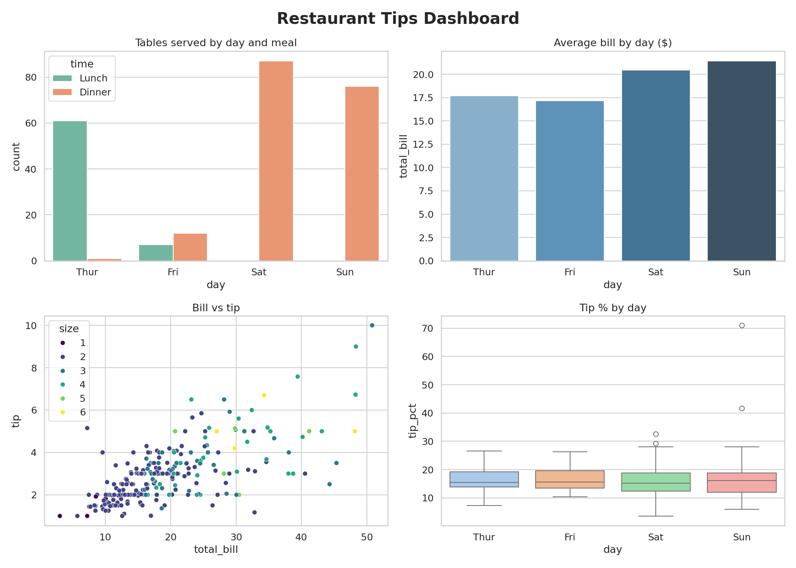

# Restaurant Tips Data Visualization - CodeAlpha Task 3

## Objective
Turn restaurant data into clear visuals that help a manager make decisions.

## Tools
Python, pandas, matplotlib, seaborn (Google Colab)

## Dashboard

## Key insights
- (average bill by day)
- (bill vs tip)
- (table served by day and meal)

## Files
- `CodeAlpha_Data_Visualization.ipynb` - full notebook
- `dashboard.png` - summary dashboard
